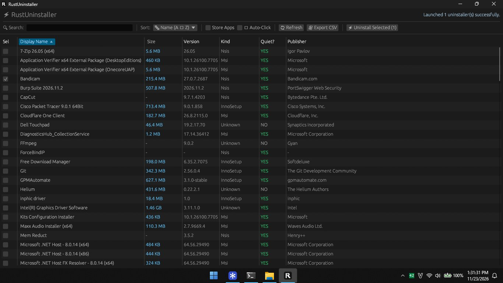

<p align="center">
  
</p>

<h1 align="center">⚡ RustUninstaller (RU)</h1>

<p align="center">
  <b>Blazing fast, lightweight, and modern native Windows uninstaller written in pure Rust.</b><br>
  Instant launch (< 15ms) • Zero .NET runtime dependency • Single binary (~3.8 MB)
</p>

<p align="center">
  
  
  
  
  
</p>

---

## 📷 Screenshot

<p align="center">
  
</p>

---

## ✨ Features

- ⚡ **Instant Scanning:** Reads 32-bit and 64-bit Windows Uninstall registries in milliseconds using direct native Win32 APIs.
- 🪶 **Ultra Lightweight:** Compiled into a single ~3.8 MB executable. Consumes under 25 MB of RAM.
- 🎯 **Quiet / Silent Uninstall Support:** Detects installer engine types (NSIS, InnoSetup, MSI, InstallShield) and dispatches automated silent uninstallation flags (`/S`, `/VERYSILENT`, `/qn`).
- 🔄 **Real-Time Process Tracking:** Automatically monitors uninstaller process termination and refreshes the application list dynamically without user intervention.
- 🛡️ **Zero Runtime Bloat:** No Electron, no WebView2, no .NET Framework / Runtime required. Runs out of the box on Windows 10 and 11.
- 🖱️ **Shell Integration:** Context menu support to launch uninstallation right from Windows Explorer.

---

## 🚀 Quick Start

### Download Pre-built Binary
Go to the **[Releases](../../releases)** tab and download `rust-uninstaller.exe`. Run directly without installation.

### Building from Source

Ensure you have Rust installed ([rustup.rs](https://rustup.rs/)):

```bash
# Clone repository
git clone https://github.com/BigBoi27566/rust-uninstaller.git
cd rust-uninstaller

# Run unit tests
cargo test --workspace

# Build optimized release binary
cargo build --release -p bcu-gui
```

The output binary will be located at: `target/release/bcu-gui.exe` (or `dist/rust-uninstaller.exe`).

---

## 📦 Project Architecture

RustUninstaller follows a clean, modular Cargo workspace:

```
RustUninstaller/
├── crates/
│   ├── bcu-core/    # Native registry scanners, engine heuristics, uninstallation dispatcher
│   ├── bcu-gui/     # Fast immediate-mode GUI powered by egui/eframe with custom branding
│   ├── bcu-cli/     # Headless CLI tool for batch and terminal workflows
│   └── bcu-ffi/     # C ABI export for external integrations
├── assets/          # Application icons and branding assets
└── installer/       # Inno Setup compilation script & context menu registry tweaks
```

---

## 💡 Acknowledgements & Heritage

RustUninstaller was inspired by and originated as a native Rust reimplementation of the legendary [Bulk Crap Uninstaller (BCU)](https://github.com/Klocman/Bulk-Crap-Uninstaller) by [Marcin Szeniak (Klocman)](https://github.com/Klocman). 

We would like to express our deepest gratitude to Marcin Szeniak and the BCU contributors for creating the gold standard uninstaller for Windows. RustUninstaller aims to carry forward that legacy into a lightweight, instant-startup, pure native Rust ecosystem.

---

## 🤝 Community & Feedback

We encourage everyone to **download, try it out, and share feedback!** 

Your ideas and real-world usage help make RustUninstaller even better:
- **Found a bug or an app that uninstalls unexpectedly?** Open an [Issue](https://github.com/BigBoi27566/rust-uninstaller/issues).
- **Want to add a feature or improve performance?** Pull Requests are warmly welcomed! Check out open [Pull Requests](https://github.com/BigBoi27566/rust-uninstaller/pulls) or start a discussion.

---

## 📄 License

Licensed under the [Apache License, Version 2.0](LICENSE).
